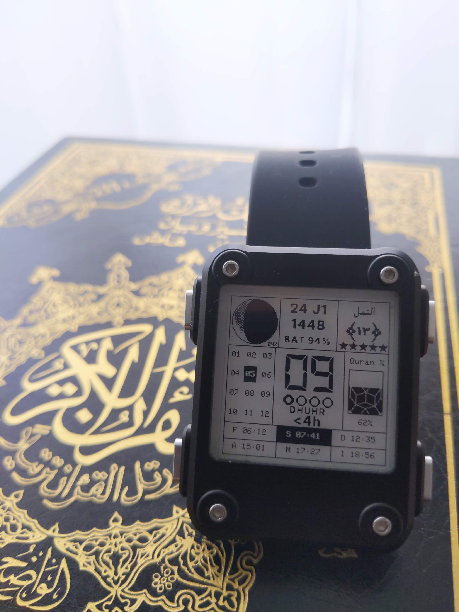
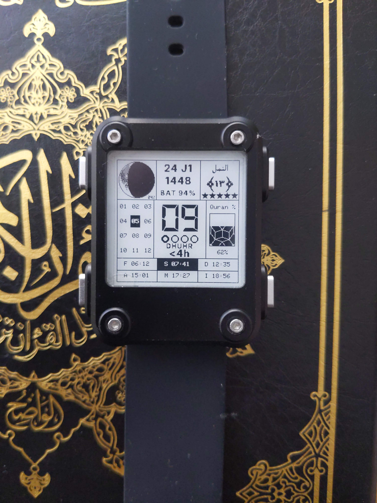
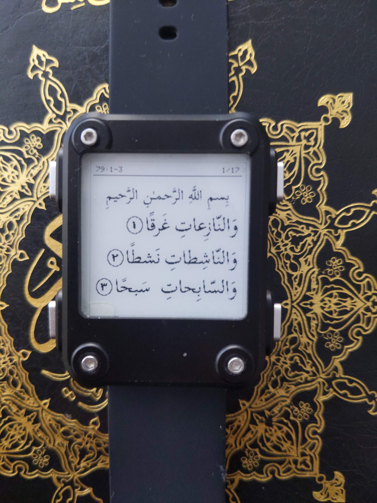
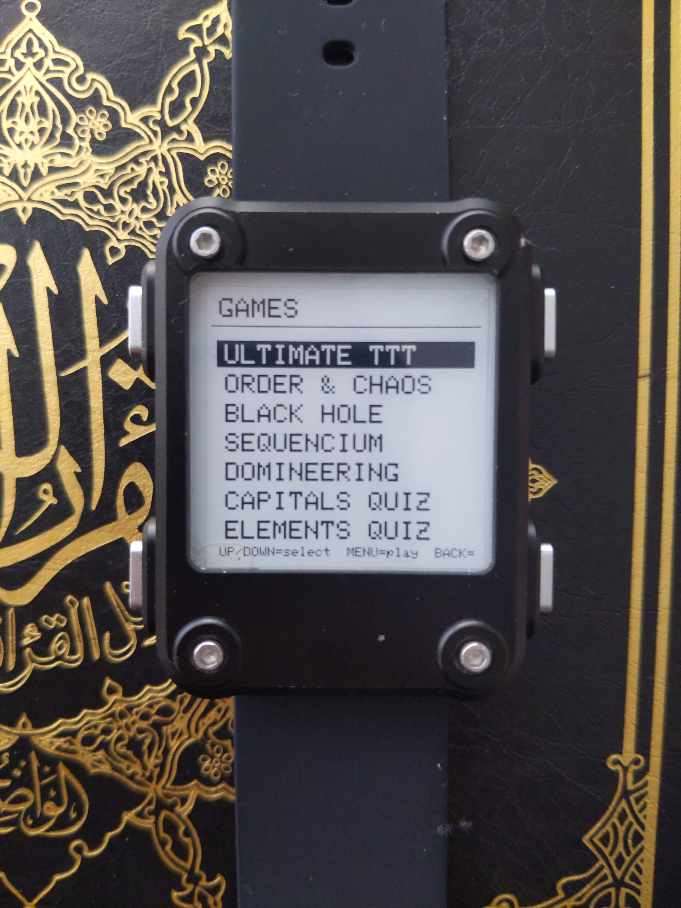
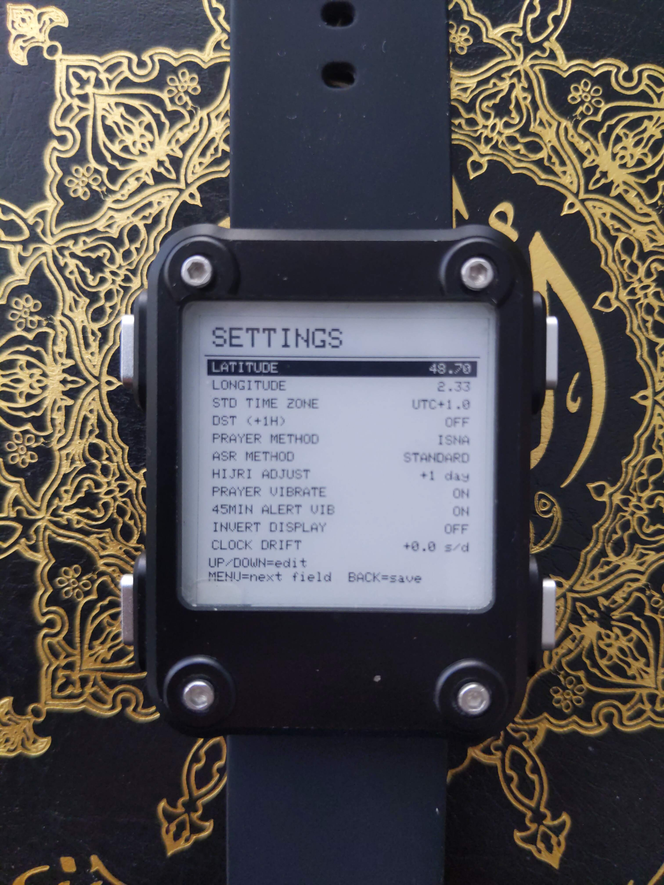
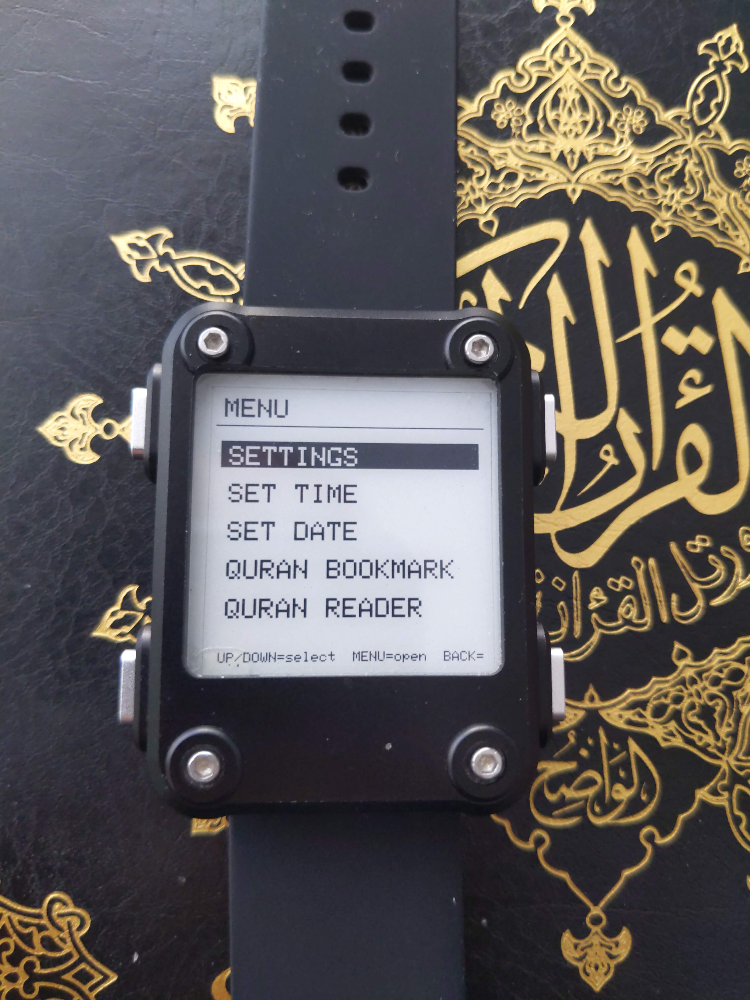

# QuranWatch


<p align="center">
  
</p>


A custom watch face and mini-apps for the **Watchy V2** e-paper smartwatch
(ESP32, 200 x 200 monochrome screen), built with PlatformIO.

It shows the time together with the lunar phase, the Hijri date, the five
daily prayer times and your Quran reading progress. It also contains an
offline Quran reader (Juz Amma + Ayat al-Kursi), a few mathematical games and
a "contemplation" mode that slowly draws an Ulam spiral of the prime numbers.

Everything on the screen is in English and plain ASCII (or one-bit bitmaps for
Arabic), so the project can be used by anyone.

> **Please read before relying on it:** prayer times use standard solar-angle
> formulas (typically within about a minute) and the Hijri date is the
> arithmetic (tabular) calendar plus a manual day adjustment. It does **not**
> replace your local moon-sighting authority or your local prayer timetable.

Licensed under the **GNU General Public License v3.0** (see [License](#license)).

---

## Features

### Watch face (9 zones)

<p align="center">
  
</p>

| Zone | Content |
|---|---|
| Moon | Moon phase computed mathematically (Meeus algorithm, no phase bitmaps), photo-derived surface texture on the lit side, illumination in % |
| Info | Gregorian and Hijri date, battery (inverted with `!` when low) |
| Bookmark | Surah and verse you reached (`S###:###`), surah name in Arabic, 5 "reading stars" (one is lost every 24 h after the last bookmark change) |
| Hijri grid | The 12 Hijri months as a grid, the current month circled |
| Hour | Large 7-segment hour digits inside a square frame that fills quarter by quarter; special-day messages and "&lt;45min / &lt;30min / &lt;15min / Now" prayer alert under the dots |
| Progress bar | a vertical bar with a Penrose-tiling texture: total Quran progress by pages (n/604) |
| Prayers | Fajr, Shuruq, Dhuhr, Asr, Maghrib, Isha; the current prayer is boxed |

Special days (Ashura, Arafah, Eid al-Adha, the last 10 nights of Ramadan, with
a "D-1" warning) are announced under the quarter-hour dots.

### Prayer times

* Methods: MWL, ISNA, Egyptian, Karachi, Umm al-Qura, Tehran, JAKIM,
  Moonsighting Committee (fixed-angle approximation), UOIF.
* Asr: Standard or Hanafi.
* Optional vibration at each prayer (not at sunrise) and one pulse when the
  "&lt;45min" alert appears.

### Quran reader

<p align="center">
  
</p>

Juz Amma (surahs 78 to 114) and Ayat al-Kursi, displayed in Arabic like a
mushaf page: continuous verses, justified lines, a Basmala line, a ring with
the verse number at the end of each verse. The text is stored as one-bit word
images, so no font or text shaping is needed on the watch. It returns to the
watch face after 10 minutes without a button press.

### Games

<p align="center">
  
</p>

Open the game menu with the **top-right button (UP)** from the watch face.

| Game | Players |
|---|---|
| Ultimate Tic-Tac-Toe | 1 or 2 (robot: easy / hard) |
| Order and Chaos (6x6) | 1 or 2 |
| Black Hole (21-circle pyramid) | 1 or 2 |
| Sequencium (6x6, 1-2-3 start) | 1 or 2 |
| Domineering | 1 or 2 |
| Capitals Quiz | 185 countries, easy / hard, 10 questions, a world map (Equal Earth projection) after each answer |
| Elements Quiz | periodic table: symbols, atomic numbers, families; easy / hard |

The board games come from the book *Math Games with Bad Drawings* by Ben
Orlin (rules only; this project contains no text or drawings from the book and
is not affiliated with it). Holding UP/DOWN moves the cursor faster (1, 3 or 6
steps) because e-paper refreshes slowly. BACK asks for confirmation while a
game is in progress. Scores are not stored.

### Contemplation mode (Ulam spiral)

Long press **BACK** (3 s) on the watch face. 1 sits at the centre, the numbers
wind outwards in a square spiral and every prime gets a dot. The number line
advances **one number per minute** since the first opening, so a prime appears
every few minutes, less and less often. First stage: 2 x 2 px dots up to 8100
(about 5.6 days), then 1 x 1 px dots up to 32400 (about 22 days in total). The
number reached only depends on elapsed time (stored in flash): nothing runs
while the mode is closed. In the mode, a long press on MENU asks to restart
from 1.

### Time handling

<p align="center">
  
</p>


* The RTC chip is **never written** (some Watchy V2 clones misbehave on RTC
  writes). Displayed time = RTC + a stored offset + DST shift + drift correction.
* **DST** toggle shifts the clock and the prayer times (TIME ZONE is the
  standard, non-DST offset).
* **Clock drift** setting: +/- 30.0 s per day in 0.1 s steps, to calibrate each
  watch.
* **Hijri adjustment**: a few days either way, to follow your local sighting.
* A software "invert display" option swaps ink and paper on the whole screen.

### Display speed

Menus, settings, bookmark editor, Quran reader and games use the e-paper's fast
**partial refresh**. A full refresh (which clears faint ghosting) happens when
the screen type changes and every `QW_FULL_EVERY` button presses (default 15,
in `main.cpp`). The watch face itself always uses a full refresh.

---

## Buttons

Watchy V2 layout: MENU top-left, BACK bottom-left, UP top-right, DOWN
bottom-right.

| Button | Watch face | In menus and screens |
|---|---|---|
| MENU short | main menu | enter item / next field |
| MENU long (3 s) | Quran bookmark editor | (in the spiral: restart) |
| BACK short | - | save and return to the watch face |
| BACK long (3 s) | contemplation mode (spiral) | - |
| UP | games menu | up / increase (hold = accelerate) |
| DOWN short | - | down / decrease |
| DOWN long (1.2 s) | Quran reader at the last verse read | - |

<p align="center">
  
</p>


Main menu: SETTINGS, SET TIME, SET DATE, BOOKMARK, READER.
Settings: latitude, longitude, UTC offset, DST, prayer method, Asr method,
Hijri adjustment, prayer vibration, alert vibration, invert display, clock drift.

---

## Build and flash

1. Install [PlatformIO](https://platformio.org/).
2. Put the sources in `src/` next to `platformio.ini`:

```ini
[platformio]
default_envs = watchy_v2

[env:watchy_v2]
platform = espressif32@~6.6.0
board = esp32dev
framework = arduino

lib_deps =
    sqfmi/Watchy

lib_ldf_mode = deep+

board_build.partitions = min_spiffs.csv

upload_speed = 115200
monitor_speed = 115200
monitor_port = /dev/ttyACM0
```

3. Set your serial port (`monitor_port`) and run `pio run -t upload`.
4. On first boot, set the time and date in the menu, then your latitude,
   longitude and UTC offset in SETTINGS (the defaults are for Paris).

The firmware uses roughly 80 % of the flash with the `min_spiffs.csv` partition
table (most of it is the Quran text images); check the size report after each
build when you add data.

### Main settings in the code

| Constant | File | Meaning |
|---|---|---|
| `QW_FULL_EVERY` | `main.cpp` | presses between two full e-paper refreshes |
| `READER_TIMEOUT_MIN` | `main.cpp` | minutes before reader, games and spiral return to the watch face |
| `LOW_BATTERY_PERCENT` | `AppConfig.h` | threshold of the low-battery warning (inverted line and SOS vibration) |
| `MINUTES_PER_NUMBER` | `Spiral.h` | pace of the Ulam spiral |

## Project layout

| File | Role |
|---|---|
| `main.cpp` | watch face class, time/drift, vibrations, screen refresh |
| `AppConfig.h`, `Storage.h` | settings, defaults, flash storage |
| `InputHandler.h` | button handling, menus, settings screens |
| `UiLayout.h`, `UiCommon.h` | watch face drawing, bitmap fonts, helpers |
| `MoonPhase.h`, `HijriCalendar.h`, `PrayerTimes.h` | astronomical and calendar maths |
| `QuranData.h` | surah and verse tables, progress maths |
| `QuranReader.h`, `QuranReaderData.h`, `SurahNames.h` | Arabic reader and surah names (generated bitmaps) |
| `Games.h`, `Game*.h` | game registry and the games |
| `CapitalsMap.h` | world map bitmap and capital coordinates (generated) |
| `Spiral.h` | Ulam spiral contemplation mode |

### Adding a game

Write the game in its own header (state in `RTC_DATA_ATTR` variables, a
namespace, and `start`, `draw`, `up`, `down`, `select` functions), include it
in `Games.h` and add one line to `QW_GAMES[]`. The menu, the BACK confirmation
and the time-out are handled for you. Remember that e-paper redraws slowly:
games must be turn-based.

### Adding a country to the capitals quiz

Add one line to `DATA[]` in `GameCapitals.h` (name, capital, continent,
well-known 0/1, optional note) **and** one line with the latitude and longitude
(in tenths of a degree) at the same position in `QW_CAP_LATLON[]` in
`CapitalsMap.h`. A compile-time check fails if the two lists differ in size.

---

## Credits and licenses

QuranWatch is free software under the GPL v3. The following third-party data
is included. **Please keep these notices if you redistribute the project.**

* **Quran text** - [Tanzil Project](https://tanzil.net), *Tanzil Quran Text
  (Simple Minimal, Version 1.1)*, (c) 2007-2026 Tanzil Project, licensed
  Creative Commons Attribution 3.0. The text is not modified. The full notice
  is kept at the top of `QuranReaderData.h`; check for updates at
  <http://tanzil.net/updates/>.
* **Scheherazade New** (Arabic reader words) - (c) 1994-2026 SIL Global,
  SIL Open Font License 1.1.
* **Lateef** (surah names) - (c) 1994-2025 SIL Global, SIL Open Font License 1.1.
* **DSEG7 Modern** (hour digits) - (c) 2018 keshikan
  (<http://www.keshikan.net>), SIL Open Font License 1.1.
* **Inter Display** (date and battery lines) - (c) The Inter Project Authors,
  SIL Open Font License 1.1.
  The fonts were only used offline to render one-bit bitmaps; no font file is
  shipped in the firmware.
* **World map** (`CapitalsMap.h`) - map illustration from
  [Equal Earths](https://equalearths.com) (released under CC0, see
  <https://equalearths.com/terms>), whose borders come from
  [Natural Earth](https://www.naturalearthdata.com) (public domain), in the
  Equal Earth projection (Savric, Patterson and Jenny, 2018). Reduced to a
  200 x 90 one-bit bitmap.
* **Moon texture** - one-bit image derived from a photograph of the full moon.
* **Moon phase** - formulas from Jean Meeus, *Astronomical Algorithms*.
* **Games** - rules from *Math Games with Bad Drawings* by Ben Orlin;
  the code is original to this project.

## License

Copyright (C) sirrol.

This program is free software: you can redistribute it and/or modify it under
the terms of the GNU General Public License as published by the Free Software
Foundation, either version 3 of the License, or (at your option) any later
version.

This program is distributed in the hope that it will be useful, but WITHOUT ANY
WARRANTY; without even the implied warranty of MERCHANTABILITY or FITNESS FOR A
PARTICULAR PURPOSE. See the GNU General Public License for more details.
