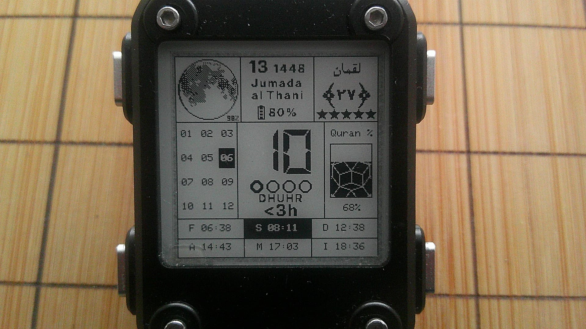
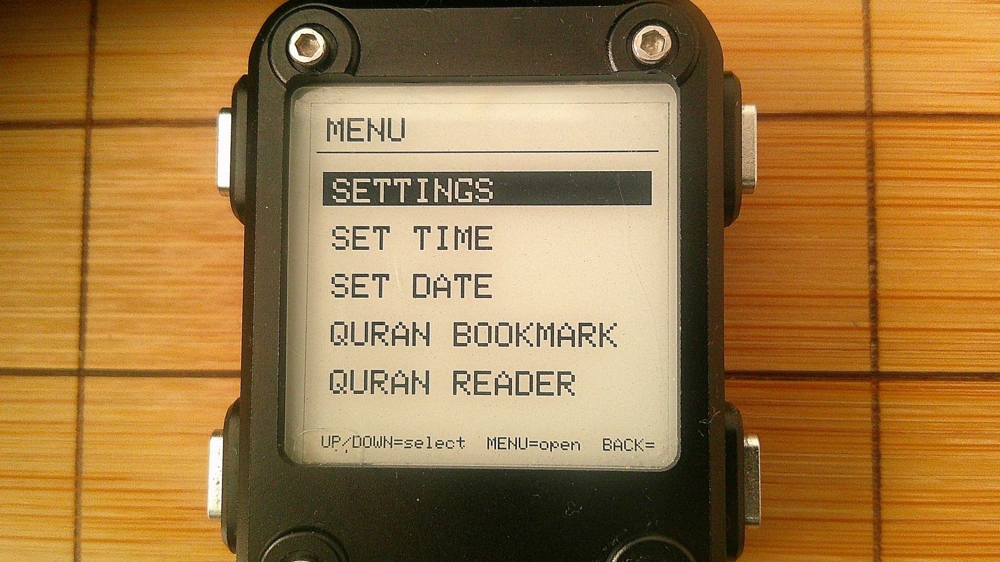
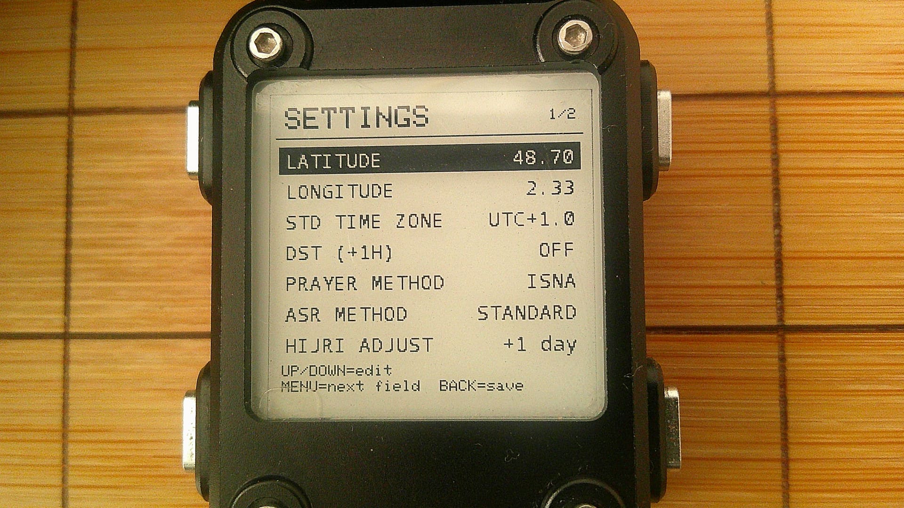
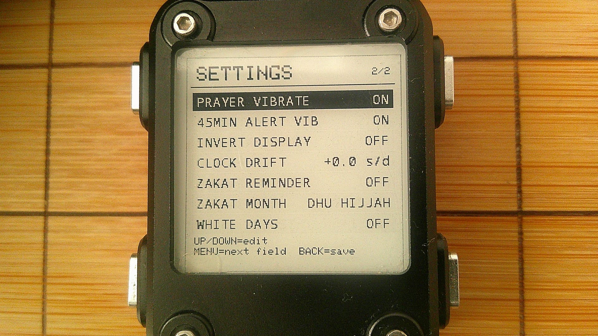
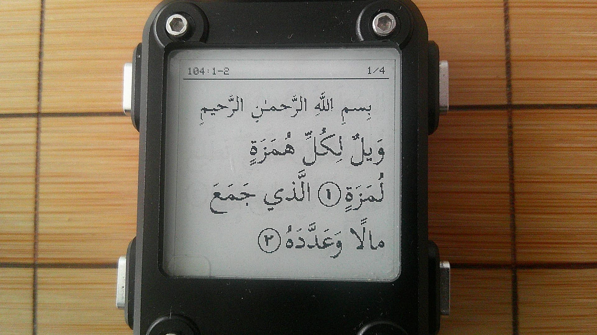
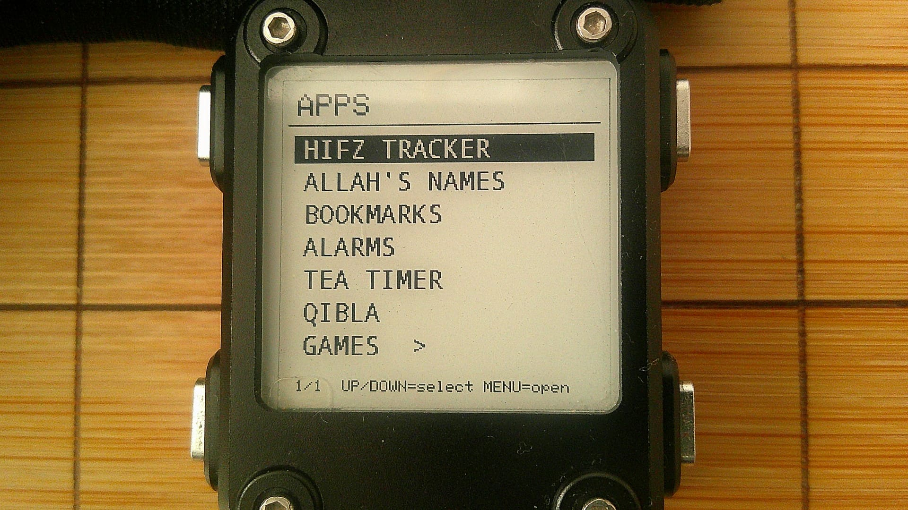
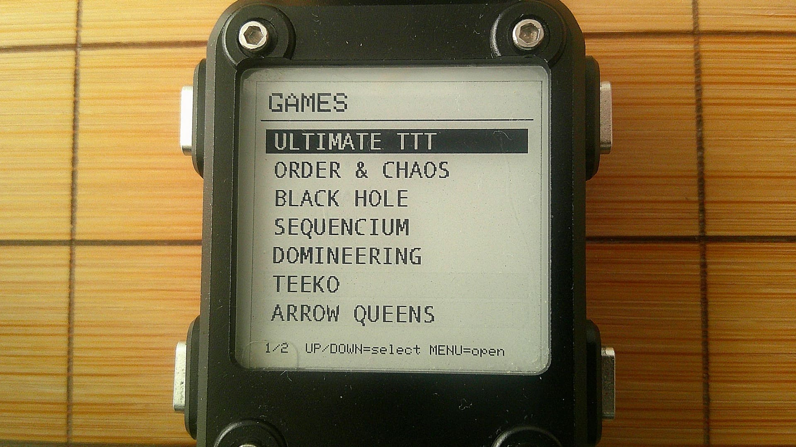
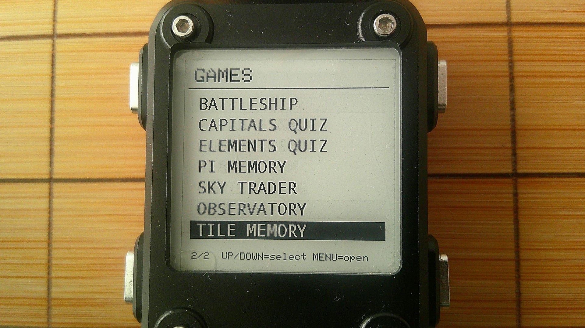
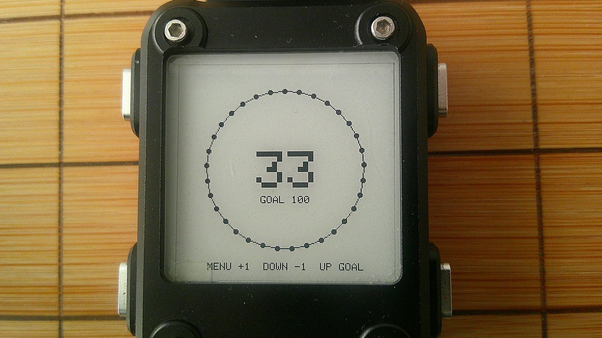
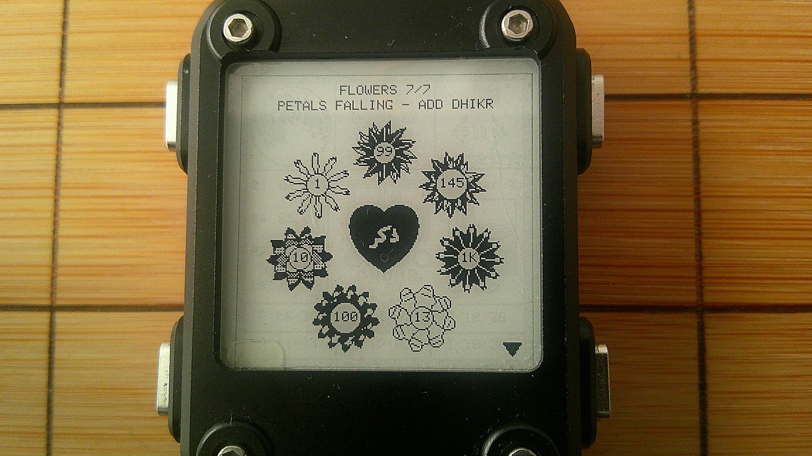

# QuranWatch

p align="center">
  
</p>

A custom watch face and a set of mini-apps for the **Watchy V2** e-paper
smartwatch (ESP32, 200 x 200 monochrome screen), built with PlatformIO.

It shows the time together with the lunar phase, the Hijri date, the five daily
prayer times and your Quran reading progress. Around it there are an offline
Quran reader (Juz Amma + Ayat al-Kursi), a dhikr bloom and a tasbih, a Hifz
(memorisation) tracker, a quiz on the Names of Allah, alarms, a tea timer, a
Qibla finder, and fourteen games and learning games.

Everything on the screen is in English and plain ASCII (or one-bit bitmaps for
Arabic, Urdu and the other bitmap texts), so the project can be used by anyone.

> **Please read before relying on it:** prayer times use standard solar-angle
> formulas (typically within about a minute), the Hijri date is the arithmetic
> (tabular) calendar plus a manual day adjustment, and the Qibla is the
> great-circle bearing from true north. None of this replaces your local
> moon-sighting authority, your local prayer timetable or a real compass.

Licensed under the **GNU General Public License v3.0** (see [License](#license)).

---

## Features

p align="center">
  
</p>

### Watch face

| Zone | Content |
|---|---|
| Moon | Moon phase computed mathematically (Meeus algorithm, no phase bitmaps), photo-derived surface texture on the lit side, illumination in % |
| Status | Hijri day (large) with the small year, full Hijri month name, Gregorian date, a vertical 4-segment battery cell with its percentage (inverted when low). This zone also shows the temporary messages and pictures listed below |
| Bookmark | Surah and verse you reached (`S###:###`), surah name in Arabic, 5 "reading stars" (one is lost every 24 h after the last bookmark change) |
| Hijri grid | The 12 Hijri months as a grid, the current month circled |
| Hour | Large 7-segment hour digits inside a square frame that fills quarter by quarter; special-day messages and the "<45min / <30min / <15min / Now" prayer alert under the dots |
| Progress bars | Three vertical bars with a Penrose-tiling texture: surahs read, progress in the current surah, and total Quran progress by pages (n/604) |
| Prayers | Fajr, Shuruq, Dhuhr, Asr, Maghrib, Isha; the current prayer is boxed |

Special days (Ashura, Arafah, Eid al-Adha, the last 10 nights of Ramadan, with a
"D-1" warning) are announced under the quarter-hour dots.

**Temporary messages in the status zone** (each stays until a short press on
BACK, and several are saved in flash so they survive deep sleep):

* **TEA TIMER**: a cup with steam when your tea is ready (highest priority).
* **Sakura crest**: appears while dhikr flowers are losing petals (see Dhikr bloom).
* **Eid greeting**: Arabic greeting at 9:00 on 1 Shawwal and on 10 Dhu al-Hijjah.
* **SACRED MONTH**: during the four sacred months (Muharram, Rajab, Dhu al-Qadah, Dhu al-Hijjah).
* **ZAKAT**: "TIME TO PREPARE ZAKAT" on day 1 of the Hijri month you choose, at Dhuhr (optional, in SETTINGS).
* **WHITE DAYS**: "WHITE DAYS START TOMORROW" on day 12 of each Hijri month, the eve of the 13th, 14th and 15th (optional, in SETTINGS; not shown in Dhu al-Hijjah, whose 13th is a day of Tashreeq when fasting is not allowed).
* **HIFZ TIME** and **ALARM** pictures when a Hifz or ALARMS alarm rings.

### Prayer times

p align="center">
  
</p>

p align="center">
  
</p>

* Methods: MWL, ISNA, Egyptian, Karachi, Umm al-Qura, Tehran, JAKIM,
  Moonsighting Committee (fixed-angle approximation), UOIF.
* Asr: Standard or Hanafi.
* Optional vibration at each prayer (not at sunrise) and one pulse when the
  "<45min" alert appears.

### Quran reader

p align="center">
  
</p>

Juz Amma (surahs 78 to 114) and Ayat al-Kursi, displayed in Arabic like a
mushaf page: continuous verses, justified lines, a Basmala line, a ring with the
verse number at the end of each verse. The text is stored as one-bit word
images, so no font or text shaping is needed on the watch. It returns to the
watch face after 10 minutes without a button press.

### APPS menu

p align="center">
  
</p>

Press **UP** (top-right) on the watch face. The menu lists the apps, then a
**GAMES** line that opens the games.

| App | What it does |
|---|---|
| **HIFZ TRACKER** | Quran memorisation: marks per ayah (not set / to learn / learning / memorized / to review), free portions, repetition counter, summary and streak. Planned reviews with spaced intervals (forgot = closer, editable dates, difficulty), a daily goal in ayat, lines or pages, a path of your choice (simple, sabak-sabqi-manzil, or free) and an error journal (confused ayat, difficult starts, link errors; optional teacher check). Optional alarm (time and weekdays) that shows "Hifz time" on the watch face |
| **ALLAH'S NAMES** | Quiz on 107 Names of Allah: 10 questions per round, Arabic name to meaning or meaning to Arabic name, a learn mode, progress kept in flash, and the meaning explained after each answer. Languages: English, French, Indonesian, Malay, Urdu, Turkish |
| **BOOKMARKS** | Up to 12 books with title, current page, optional total pages (percentage and bar) and the date you last read |
| **ALARMS** | Several named alarms with weekday choice, a quick same-day alarm, and Morse vibration patterns (UP, GO, RISE, ARISE, WAKE); a sonar-style picture appears in the status zone when one rings |
| **TEA TIMER** | Green 2 min, White 3, Oolong 4, Black 4, Herbal 6, Rooibos 6 (water temperature shown for each), 15 s adjustment steps, a CUSTOM duration. When ready it vibrates, shows a cup on the watch face, and vibrates again one minute later if you have not pressed BACK |
| **QIBLA** | Direction of the Kaaba in degrees from true north, compass point, distance and a compass rose. Your own places are stored by name (up to 30, coordinates in decimal degrees) and any place can be copied into SETTINGS to be used for the prayer times (the time zone is not changed) |

The watch has no compass sensor: line the Qibla angle up with a compass or a
phone. BACK inside an app goes up one level; leaving an app asks for
confirmation.

### Games and learning games (APPS > GAMES)

p align="center">
  
</p>

p align="center">
  
</p>

| Game | Players |
|---|---|
| Ultimate Tic-Tac-Toe | 1 or 2 (robot: easy / hard) |
| Order and Chaos (6x6) | 1 or 2 |
| Black Hole (21-circle pyramid) | 1 or 2 |
| Sequencium (6x6, 1-2-3 start) | 1 or 2 |
| Domineering | 1 or 2 |
| Teeko (5x5, 4 pieces each) | 1 or 2 (robot: easy / hard) |
| Arrow Queens (8x8, 3 queens each) | 1 or 2 (robot: easy / hard) |
| Battleship (10x10, 5 ships) | 1 (robot: easy / hard) or 2 (pass the watch); random or manual placement |
| Capitals Quiz | 185 countries, easy / hard, 10 questions, a world map (Equal Earth projection) after each answer |
| Elements Quiz | periodic table: symbols, atomic numbers, families; easy / hard |
| Pi Memory | 1000 decimals of Pi; modes LEARN, RECITE, FROM DIGIT N, 10-DIGIT BLOCK; digits entered with UP/DOWN and MENU |
| SKY TRADER | A text-only space trading and exploration game (commerce, missions, upgrades, reputation, a local map and route planner), inspired by the free game Endless Sky |
| OBSERVATORY | A story and learning game: 30 missions about the science of the Islamic world (astronomy, optics, mathematics, medicine, navigation, paper, hospitals...). Choice questions, dials, drawings, 1 to 3 stars per mission and a CODEX of what you learned. Progress is saved |
| TILE MEMORY | Memory cards showing tilings of the plane (regular and irregular polygon tilings, all drawn by code), 3 board sizes, 1 or 2 players, best score kept in solo |

The board games come from the book *Math Games with Bad Drawings* by Ben Orlin
(rules only; this project contains no text or drawings from the book and is not
affiliated with it). Holding UP/DOWN moves the cursor faster (1, 3 or 6 steps)
because e-paper refreshes slowly. BACK asks for confirmation while a game is in
progress.

### Tasbih

p align="center">
  
</p>

Long press **UP** on the watch face. Beads on a regular polygon (1 bead, 2
beads, a triangle... toward a circle), a large count in the centre and a calm
animation. Goal: FREE, 33, 99 or 100. MENU adds 1, DOWN removes 1, the count is
kept in flash and BACK offers to add it to today's dhikr.

### Contemplation mode (Ulam spiral)

Long press **BACK** (3 s) on the watch face. 1 sits at the centre, the numbers
wind outwards in a square spiral and every prime gets a dot. The number line
advances **one number per minute** since the first opening, so a prime appears
every few minutes, less and less often. First stage: 2 x 2 px dots up to 8100
(about 5.6 days), then 1 x 1 px dots up to 32400 (about 22 days in total). The
number reached only depends on elapsed time (stored in flash): nothing runs
while the mode is closed. The header shows the last prime. In the mode, a long
press on MENU asks to restart from 1.

### Dhikr bloom

p align="center">
  
</p>

Short press **DOWN** on the watch face. When it opens, the flowers are closed
buds that turn once around the heart in steps of 45 degrees (the heart beats),
then they open. The heart carries the word ذكر (dhikr) and is protected by a ring
of flowers, one for every day on which you did some dhikr. Press MENU, then
choose **ADD 33**, **ADD 99**, **ADD 100** or **ADD FREE** (type a number from
1 to 999, hold UP/DOWN to go faster); **UNDO LAST** cancels the last entry. DOWN
on the main screen opens the **trophies**.

* 1 flower, then 2 side by side, 3 in a triangle... up to 7 in a heptagon.
* Each flower has its own species (18 in all, drawn by code from real flowers
  such as daisy, sunflower, plumeria, poppy, pansy, tulip, marigold, dahlia, lily,
  peony, clover, rose and hydrangea). The number in the middle is that day's dhikr
  total (1K, 2K... from 1000). Each time you add dhikr the flower gets more petals
  (up to 7 extra) and new "colours" (solid, dots or checker fills, layer by layer).
* With 7 flowers the heart is fully protected: a heart-shaped envelope surrounds
  it. It disappears after 36 h without dhikr.
* When the ring is full and a new day starts, the oldest flower leaves the frame
  and the new one opens in its place. The flower that left is kept on the
  **trophies** page (8 per line, up to 56; when it is full, flowers that leave are
  no longer kept). BACK returns from the trophies.
* After 24 h without dhikr the oldest flower of the ring loses one petal every
  6 hours; the sakura crest appears on the watch face while petals are falling
  (hollow petals are the ones already lost). When its last petal is gone the
  flower dies (it does not become a trophy) and the next oldest flower is next.
  Adding dhikr gives all its petals back; a dead flower stays dead.
* A day is a 24 h period since the last counted day, measured on the raw RTC, so
  changing the clock never affects it.

The record is kept in flash and nothing runs while the screen is closed.

### Time handling

* The RTC chip is **never written** (some Watchy V2 clones misbehave on RTC
  writes). Displayed time = RTC + a stored offset + DST shift + drift correction.
* **DST** toggle shifts the clock and the prayer times (TIME ZONE is the
  standard, non-DST offset).
* **Clock drift** setting: +/- 30.0 s per day in 0.1 s steps, to calibrate each
  watch.
* **Hijri adjustment**: a few days either way, to follow your local sighting.
* A software "invert display" option swaps ink and paper on the whole screen.
* The TEA TIMER arms an ESP32 timer wake-up at the exact end of the brew and
  falls back on the minute tick; the wake-up has not been tested on every
  Watchy clone.

### Display speed

Menus, settings, bookmark editor, Quran reader, apps and games use the
e-paper's fast **partial refresh**. A full refresh (which clears faint ghosting)
happens when the screen type changes and every `QW_FULL_EVERY` button presses
(default 15, in `main.cpp`). The watch face itself always uses a full refresh.

---

## Buttons

Watchy V2 layout: MENU top-left, BACK bottom-left, UP top-right, DOWN
bottom-right.

| Button | Watch face | In menus and screens |
|---|---|---|
| MENU short | main menu | enter item / next field |
| MENU long (3 s) | Quran bookmark editor | (in the spiral: restart) |
| BACK short | hides the current message in the status zone | go back one level / return to the watch face |
| BACK long (3 s) | contemplation mode (spiral) | - |
| UP short | APPS menu | up / increase (hold = accelerate) |
| UP long | tasbih | - |
| DOWN short | dhikr bloom | down / decrease |
| DOWN long (1.2 s) | Quran reader at the last verse read | - |

Main menu: SETTINGS, SET TIME, SET DATE, BOOKMARK, READER.
SETTINGS (two pages): latitude, longitude, UTC offset, DST, prayer method, Asr
method, Hijri adjustment, prayer vibration, alert vibration, invert display,
clock drift, zakat reminder (on/off and Hijri month), White Days reminder (on/off).

---

## Build and flash

1. Install [PlatformIO](https://platformio.org/).
2. Put the sources in `src/` next to `platformio.ini`:

```ini
[platformio]
default_envs = watchy_v2

[env:watchy_v2]
platform = espressif32@~6.6.0
board = esp32dev
framework = arduino

lib_deps =
    sqfmi/Watchy

lib_ldf_mode = deep+

board_build.partitions = min_spiffs.csv

upload_speed = 115200
monitor_speed = 115200
monitor_port = /dev/ttyACM0
```

3. Set your serial port (`monitor_port`) and run `pio run -t upload`.
4. On first boot, set the time and date in the menu, then your latitude,
   longitude and UTC offset in SETTINGS (the defaults are for Paris).

The firmware now uses about **98 %** of the flash with the `min_spiffs.csv`
partition table (most of it is the Quran text images and the language data), so
there is little room left: check the size report after every change. If you
need space, the biggest items are `QuranReaderData.h`, `ArabicNames.h`,
`UrduData.h` and `AsmaLang.h`.

### Main settings in the code

| Constant | File | Meaning |
|---|---|---|
| `QW_FULL_EVERY` | `main.cpp` | presses between two full e-paper refreshes |
| `READER_TIMEOUT_MIN` | `main.cpp` | minutes before reader, apps, spiral and bloom return to the watch face |
| `LOW_BATTERY_PERCENT` | `AppConfig.h` | threshold of the low-battery warning (inverted line and SOS vibration) |
| `MINUTES_PER_NUMBER` | `Spiral.h` | pace of the Ulam spiral |
| `QW_APP_COUNT` | `Apps.h` | how many entries of `QW_GAMES[]` are apps (the rest go in GAMES) |

## Project layout

| File | Role |
|---|---|
| `main.cpp` | watch face class, time/drift, vibrations, screen refresh |
| `AppConfig.h`, `Storage.h` | settings, defaults, flash storage |
| `InputHandler.h` | button handling, menus, settings screens |
| `UiLayout.h`, `UiCommon.h` | watch face drawing, bitmap fonts, helpers |
| `NotoMono13.h`, `NotoMono17.h` | generated menu fonts |
| `MoonPhase.h`, `HijriCalendar.h`, `PrayerTimes.h` | astronomical and calendar maths |
| `QuranData.h` | surah and verse tables, progress maths |
| `QuranReader.h`, `QuranReaderData.h`, `SurahNames.h` | Arabic reader and surah names (generated bitmaps) |
| `SacredMonth.h`, `EidMessage.h` | status-zone messages and pictures (sacred month, Eid, zakat, tea cup...) |
| `Apps.h` | registry of apps and games |
| `Hifz.h`, `Names.h`, `Books.h`, `Alarms.h`, `Tea.h`, `Qibla.h` | the apps (`AlarmCore.h` and `TeaCore.h` hold the background parts of alarms and tea) |
| `AsmaData.h`, `AsmaLang.h`, `ArabicNames.h`, `UrduData.h` | data of the Names of Allah quiz |
| `Game*.h` | the games |
| `SkyData.h` | star systems and goods of SKY TRADER |
| `CapitalsMap.h` | world map bitmap and capital coordinates (generated) |
| `Spiral.h`, `Garden.h`, `Tasbih.h` | contemplation spiral, dhikr bloom, tasbih |

### Adding an app or a game

Write it in its own header (state in `RTC_DATA_ATTR` variables, a namespace,
and `start`, `draw`, `up`, `down`, `select` functions, optionally `busy` and
`back`), include it in `Apps.h` and add one line to `QW_GAMES[]`. A game goes
after the first `QW_APP_COUNT` entries; to add an app to the APPS menu itself,
put it before the games and increase `QW_APP_COUNT`. The menu, the BACK
confirmation and the time-out are handled for you. Remember that e-paper
redraws slowly: apps and games must be turn-based.

### Adding a country to the capitals quiz

Add one line to `DATA[]` in `GameCapitals.h` (name, capital, continent,
well-known 0/1, optional note) **and** one line with the latitude and longitude
(in tenths of a degree) at the same position in `QW_CAP_LATLON[]` in
`CapitalsMap.h`. A compile-time check fails if the two lists differ in size.

---

## Credits and licenses

QuranWatch is free software under the GPL v3. The following third-party data
is included. **Please keep these notices if you redistribute the project.**

* **Quran text** - [Tanzil Project](https://tanzil.net), *Tanzil Quran Text
  (Simple Minimal, Version 1.1)*, (c) 2007-2026 Tanzil Project, licensed
  Creative Commons Attribution 3.0. The text is not modified. The full notice
  is kept at the top of `QuranReaderData.h`; check for updates at
  <http://tanzil.net/updates/>.
* **Names of Allah** - the list of 107 names, their meanings and translations
  (English, French, Indonesian, Malay, Urdu, Turkish) are taken from
  [asmaalhusna.com](https://www.asmaalhusna.com). Check the site's terms before
  redistributing the data.
* **Scheherazade New** (Arabic reader words, the word ذكر in the heart, Arabic
  and Urdu names) - (c) 1994-2026 SIL Global, SIL Open Font License 1.1.
* **Lateef** (surah names, Eid greeting) - (c) 1994-2025 SIL Global, SIL Open
  Font License 1.1.
* **DSEG7 Modern** (hour digits) - (c) 2018 keshikan
  (<http://www.keshikan.net>), SIL Open Font License 1.1.
* **Inter Display** (date and battery lines) - (c) The Inter Project Authors,
  SIL Open Font License 1.1.
* **Noto Sans Mono** (menus, apps and OBSERVATORY text) - (c) The Noto Project
  Authors, SIL Open Font License 1.1.
  The fonts were only used offline to render one-bit bitmaps; no font file is
  shipped in the firmware.
* **World map** (`CapitalsMap.h`) - map illustration from
  [Equal Earths](https://equalearths.com) (released under CC0, see
  <https://equalearths.com/terms>), whose borders come from
  [Natural Earth](https://www.naturalearthdata.com) (public domain), in the
  Equal Earth projection (Savric, Patterson and Jenny, 2018). Reduced to a
  200 x 90 one-bit bitmap.
* **Moon texture** - one-bit image derived from a photograph of the full moon.
  *Add the author, source and license of the photograph here.*
* **Moon phase** - formulas from Jean Meeus, *Astronomical Algorithms*.
* **Qibla** - great-circle bearing to the Kaaba (21.4225 N, 39.8262 E).
* **Games** - rules from *Math Games with Bad Drawings* by Ben Orlin; the code
  is original to this project.
* **Arrow Queens** - an implementation of the "Game of the Amazons"
  (invented by Walter Zamkauskas, 1988), played here on 8x8 with three queens
  per side as in *Math Games with Bad Drawings*. The start position is the
  table `START_BLACK` / `START_WHITE` in `GameQueenArrow.h`.
* **SKY TRADER** - inspired by the free game *Endless Sky*; it contains none of
  its code, text or art.
* **OBSERVATORY** - the characters and scenes are invented, the discoveries are
  real (al-Biruni, al-Sufi, Ibn Ridwan, al-Tusi, Omar Khayyam, Ulugh Beg,
  al-Kashi, al-Razi, al-Zahrawi, Ibn al-Nafis, al-Jazari and many others).
  Facts were checked with MacTutor and encyclopedia sources; please report any
  mistake you find.

## License

Copyright (C) sirrol

This program is free software: you can redistribute it and/or modify it under
the terms of the GNU General Public License as published by the Free Software
Foundation, either version 3 of the License, or (at your option) any later
version.

This program is distributed in the hope that it will be useful, but WITHOUT ANY
WARRANTY; without even the implied warranty of MERCHANTABILITY or FITNESS FOR A
PARTICULAR PURPOSE. See the GNU General Public License for more details.

The full text is in the `LICENSE` file (download it from
<https://www.gnu.org/licenses/gpl-3.0.txt>).
